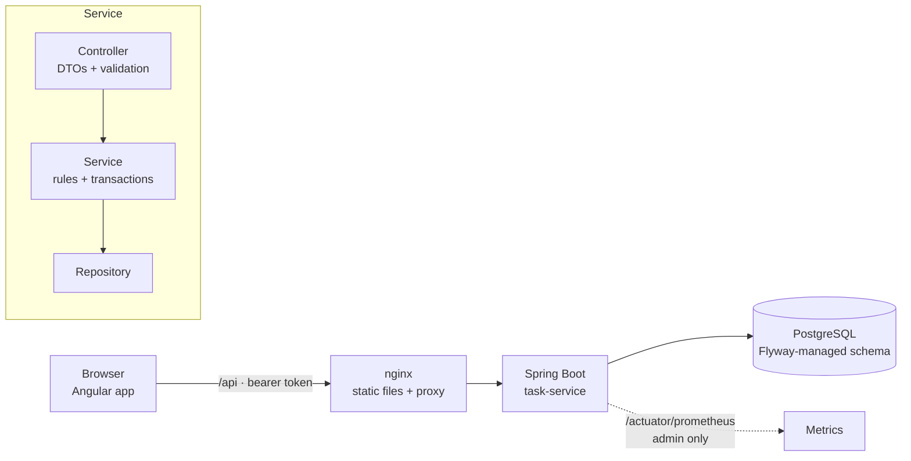

<div align="center">

# 🧱 spring-angular-project

**A production-minded full-stack starter: a Spring Boot REST API and an Angular app, built the way I would want a real service to start.**


</div>

---

## What this is

A small task manager. The domain is deliberately trivial, so the interesting part is everything around it: **the practices a real service needs from day one**: security, error handling, migrations, observability, tests that enforce the architecture, and a deployment that is locked down by default.

Use it as a starting point, or as a reference for how I approach building a service.

## What's inside

| Area | What it does |
|:--|:--|
| **API design** | Resource-oriented REST, explicit paging envelope, filtering, allow-listed sorting with a stable tie-breaker, DTOs only (the JPA entity never leaves the service layer) |
| **Errors** | Every failure is an RFC 9457 `application/problem+json` document with a **request id**. Field-level validation errors. No stack traces or internals ever reach the client |
| **Concurrency** | Optimistic locking: an update must carry the version the client last saw, and a stale one gets `409` instead of silently overwriting someone else's work. A database-level lost update is also mapped to `409` |
| **Security** | Stateless JWT bearer auth (algorithm pinned, issuer and expiry checked), role-based rules, default-deny, strict secret validation at startup, no CSRF surface, security headers, CORS only for configured origins |
| **Data** | Flyway migrations, `ddl-auto=validate` (the schema is owned by SQL, not Hibernate), audit columns filled from the token, never from the request body |
| **Observability** | Request id in the response, in every log line and in every error body. Actuator health with liveness and readiness probes, Prometheus metrics behind an admin role |
| **Architecture rules as tests** | ArchUnit fails the build if a controller touches a repository or entity, uses field injection, or the layers depend the wrong way round |
| **Frontend** | Angular 22 with standalone components and signals, lazy-loaded routes, functional interceptor and guard, typed API service, accessible markup, light and dark themes, no CSS framework |
| **Delivery** | Multi-stage Dockerfiles that run as non-root, `docker compose` with PostgreSQL, CI on every push |

## Architecture



## API

| Method and path | Role | Purpose |
|:--|:--|:--|
| `GET /api/tasks?status=&q=&page=&size=&sort=` | user | List with filtering, paging (size at most 100) and sorting (`createdAt`, `dueDate`, `title`, `status`) |
| `GET /api/tasks/{id}` | user | One task |
| `POST /api/tasks` | user | Create (`201` + `Location`) |
| `PUT /api/tasks/{id}` | user | Full update; the body must carry `version` (`409` if stale) |
| `PATCH /api/tasks/{id}/status` | user | Change the status only |
| `DELETE /api/tasks/{id}` | **admin** | Delete |
| `GET /actuator/health` (+ `/liveness`, `/readiness`) | public | Health, without component details |
| `GET /actuator/prometheus` | admin | Metrics |
| `GET /swagger-ui.html`, `/v3/api-docs` | public (off under `prod`) | Interactive API documentation |
| `POST /api/dev/token` | dev profile only | Mints a token for local use. It does not exist in any other profile |

Every error looks like this, and the id matches the `X-Request-Id` response header and the server log:

```json
{ "type": "about:blank", "title": "Validation failed", "status": 400,
  "detail": "One or more fields are invalid", "requestId": "3f0c...",
  "errors": [ { "field": "title", "message": "must not be blank" } ] }
```

## Quick start

You need Java 21, Maven and Node 22 or newer.

**1. Backend** (in-memory database, dev sign-in enabled):

```bash
cd backend
mvn spring-boot:run -Dspring-boot.run.profiles=dev
```

API on http://localhost:8080, docs at http://localhost:8080/swagger-ui.html.

**2. Frontend** (in a second terminal, proxies `/api` to the backend):

```bash
cd frontend
npm ci
npx ng serve
```

Open http://localhost:4200, sign in with any name (choose *Admin* to see the delete button) and create some tasks.

### With PostgreSQL in containers

```bash
cp .env.example .env          # then set DB_PASSWORD
docker compose up --build
```

Open http://localhost:8081. This runs the `dev,postgres` profiles, so the dev sign-in works. It is a demo setup, not a deployment.

## Running it for real

| Setting | Purpose |
|:--|:--|
| `SPRING_PROFILES_ACTIVE=prod,postgres` | Production hardening (API docs off, no dev token endpoint) and PostgreSQL |
| `SPRING_DATASOURCE_URL` / `_USERNAME` / `_PASSWORD` | Database connection |
| `APP_JWT_SECRET` | Signing secret, **at least 32 characters**. The application refuses to start without it. There is no default |
| `APP_JWT_ISSUER` | Expected token issuer (default `task-service`) |
| `APP_CORS_ORIGINS` | Comma-separated allowed origins, only needed if the UI is on a different origin |

The built-in HS256 shared secret keeps this starter self-contained. In production, tokens should come from your identity provider: replace the decoder in `SecurityConfig` with `spring.security.oauth2.resourceserver.jwt.issuer-uri` (or a JWKS URI), and sign-in moves out of this app. The role checks stay the same.

## Tests

```bash
cd backend  && mvn verify                         # 55 tests + 80% line-coverage gate
cd frontend && npx ng test --watch=false          # 33 tests
```

**Backend (55 tests, 99% line and 92% branch coverage, build fails below 80%).** API behaviour end to end against a real database: validation, paging, filtering, sort allow-list, conflicts. Security: no token, forged signature, expired token, wrong issuer, `alg: none`, wrong role, closed-by-default routes. Error shape and no information leaks. Request-id handling, including hostile values. The database-level lost-update race. Config validation (weak or missing secret stops startup). ArchUnit architecture rules.

**Frontend (33 tests).** Auth service, interceptor (token only on API calls, sign-out on 401), guard, API service, and the screens: rendering, escaping of task text, admin-only delete with confirmation, filters, paging, error messages with request ids, and form behaviour while requests are in flight.

## Honest limits

- **The Docker images and `docker compose` setup were written but not run.** Docker was not available where this was built. The Dockerfiles, `nginx.conf` and `compose.yaml` follow standard patterns but treat them as untested until you run them.
- **PostgreSQL has not been exercised.** Tests and the local run use H2 in PostgreSQL mode, and the migration is plain standard SQL. The `postgres` profile and driver are in place but unproven here.
- **The `prod` profile has not been run against a real deployment.** Its behaviour is covered by configuration and tests, not by an actual rollout.
- **CI has not run on GitHub yet.** The workflow mirrors the commands that pass locally.
- The domain is intentionally tiny. Real products add things this starter leaves out: multi-tenancy, a real identity provider, rate limiting, caching, background jobs.
- Spring Boot 3.5 (the latest 3.x line) was chosen over 4.x for stability. Angular 22 is what the CLI generated at the time.

## Project layout

```text
backend/    Spring Boot service (Maven, Java 21)
  src/main/java/com/thebytecodehq/starter/
    task/       entity, repository, service, controller, DTOs
    security/   JWT decoding, role rules, problem-style 401/403, audit, dev token
    common/     error handler, request-id filter, paging helpers
  src/main/resources/db/migration/   Flyway SQL
frontend/   Angular app
  src/app/core/    auth, interceptor, guard, API service, error formatting
  src/app/tasks/   task list screen
  src/app/login/   development sign-in
compose.yaml   PostgreSQL + backend + frontend for a local demo
```

## License

MIT
